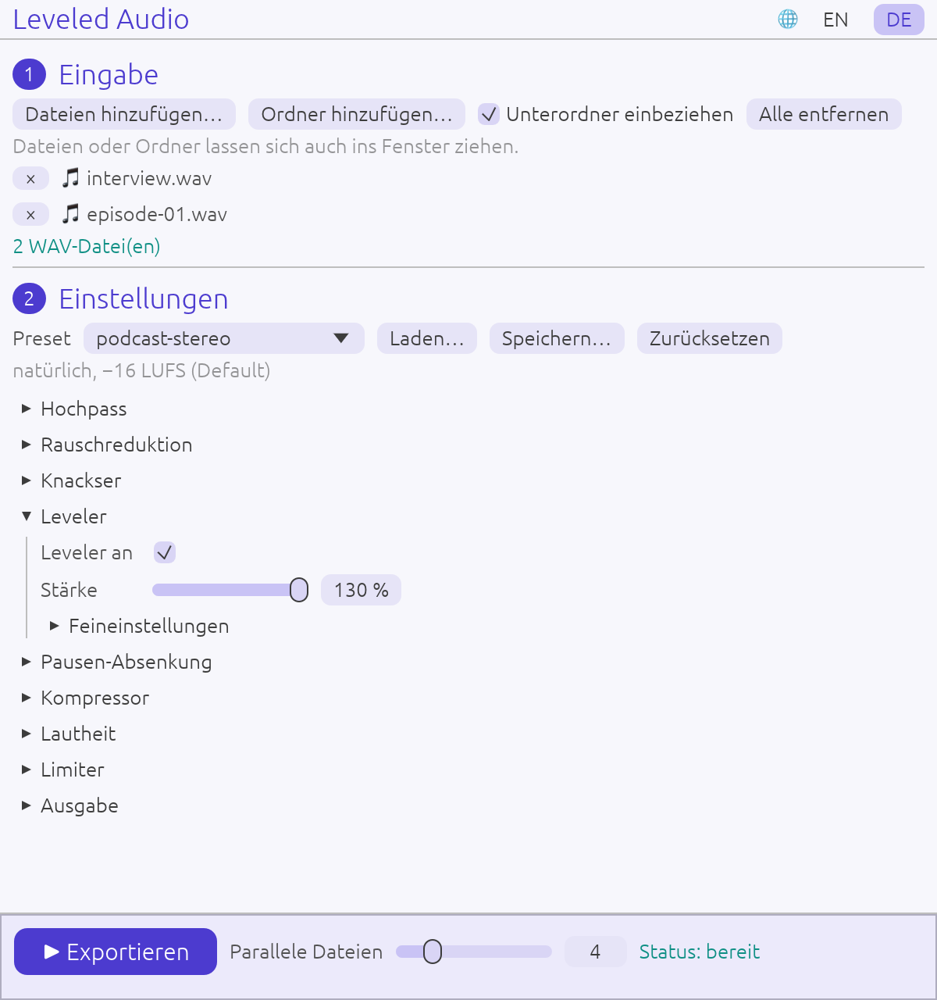
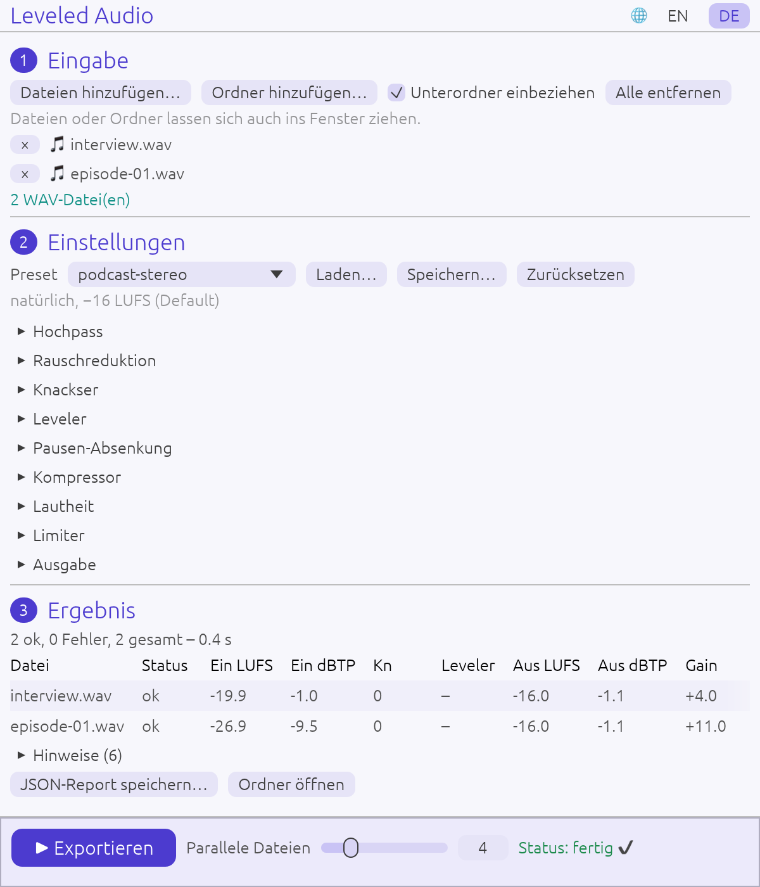

# Leveled Audio

[English](README.md) · **Deutsch**

Stapelverarbeitung von Sprachaufnahmen (WAV): offline, ohne Laufzeitabhängigkeiten. Es gibt sie als Programm mit Oberfläche (**Leveled Audio**) und als Kommandozeilenwerkzeug `leveled-audio`.

<p align="center">
  
  
</p>

**Stand: Phase 6.** Umgesetzt sind bisher:

- Hochpass.
- Rauschreduktion mit automatischem Rauschprofil.
- Erkennung und Absenkung von Griffgeräuschen.
- Adaptiver Leveler.
- Kompressor und optionale Pausen-Absenkung.
- Loudness-Normalisierung (ITU-R BS.1770-4 / EBU R128, pro Datei oder als Album) und True-Peak-Limiter.
- Presets mit Schichtung.
- JSON-Report mit Schema.
- Release-Builds.
- Eine einfache Oberfläche auf Englisch und Deutsch.

Siehe [PLAN.md](PLAN.md).

**Kette:** Hochpass → Rauschreduktion + Knackser-Absenkung → Leveler (+ Pausen-Absenkung) → Kompressor → Normalisierung → True-Peak-Limiter.

Das Rauschprofil wird automatisch aus den leisesten stationären Sprechpausen jeder Datei bestimmt. Gibt es keine, dient Minimum Statistics als Ersatz. Der Leveler gleicht unterschiedlich laute Sprecher und Phrasen an. Die Wechsel liegen in den Pausen, und Pausen werden nicht angehoben.

**Bedienungsanleitung:** [docs/ANLEITUNG.md](docs/ANLEITUNG.md) (Deutsch) · [docs/GUIDE.md](docs/GUIDE.md) (English) · **Report-Schema:** [docs/report.schema.json](docs/report.schema.json)

## Programm mit Oberfläche

- **Ablauf:** Dateien oder Ordner hinzufügen, Preset wählen und Einstellungen anpassen, dann auf **Exportieren** klicken.
- **Ablage:** Jede Datei landet **neben dem Original** als `Name-leveled-<Preset>.wav`. Gibt es die Zieldatei schon, fragt das Programm vor dem Überschreiben nach.
- **Sprache:** Die Oberfläche startet auf Englisch. Mit **EN | DE** oben rechts schaltest du auf Deutsch um.

- **macOS:** `Leveled Audio.app` (im Release-Archiv oder selbst gebaut mit `scripts/macos-app.sh`). Startet ohne Terminal-Fenster. Sie ist nicht notarisiert, deshalb beim ersten Start einmal Rechtsklick → Öffnen.
- **Windows:** `leveled-audio-gui.exe`, ohne Konsolenfenster.
- **Linux:** `leveled-audio-gui`.

Details: [Anleitung, Abschnitt 3a](docs/ANLEITUNG.md#3a-grafische-oberfläche-leveled-audio-leveled-audio-gui).

## Installation

Fertige Binaries für macOS (Universal), Windows und Linux (statisch) hängen an jedem GitHub-Release, siehe [Anleitung, Abschnitt 1](docs/ANLEITUNG.md#1-installation). Selbst bauen:

```bash
cargo build --release
scripts/macos-app.sh        # nur macOS: erzeugt target/release/Leveled Audio.app
```

Das Kommandozeilen-Binary liegt danach unter `target/release/leveled-audio`.

Ein Release entsteht durch ein Tag: `git tag v0.1.0 && git push origin v0.1.0`. Der Workflow `.github/workflows/release.yml` baut dann alle Plattformen, prüft die Binaries und lädt sie mit `SHA256SUMS.txt` hoch.

## Kommandozeile

```bash
# Ordner rekursiv auf −16 LUFS / −1 dBTP bringen
leveled-audio process aufnahmen/ -r -o fertig/

# EBU R128 (−23 LUFS), 24 bit, mit JSON-Report
leveled-audio process interview.wav -o fertig/ --preset ebu-r128 --bit-depth 24 --report-json report.json

# Kontrolle: entfernte Anteile als <name>.delta.wav, Profile speichern
leveled-audio process aufnahmen/ -o fertig/ --export-delta --save-profiles profile/

# Ein Profil (z. B. aus einer Raumton-Aufnahme) für alle Dateien erzwingen
leveled-audio profile learn raumton.wav -o studio.json
leveled-audio process aufnahmen/ -o fertig/ --noise-profile studio.json

# Album: ein gemeinsamer Gain, relative Unterschiede bleiben
leveled-audio process staffel/ -o fertig/ --loudness-mode album

# Eigenes Preset (fehlende Werte kommen vom Basis-Preset) und einzelne Overrides
leveled-audio preset show ebu-r128 > mein.toml
leveled-audio process aufnahmen/ -o fertig/ --preset mein.toml --set denoise.reduction_db=15

# Kräftiger Klang (Pausen fast still, dichter) statt natürlich
leveled-audio process aufnahmen/ -o fertig/ --preset podcast-kraeftig

# Einzelne Regler (Empfehlungen und Wirkung: Anleitung, Abschnitt 4)
leveled-audio process interview.wav -o fertig/ --pause-floor -60 --compression 60 --knock-reduction 20

# Leveler sanfter (Default 130 %, überkorrigierend) oder ganz aus
leveled-audio process interview.wav -o fertig/ --leveler-strength 60
leveled-audio process interview.wav -o fertig/ --no-leveler

# Stärker entrauschen, oder Rauschreduktion ganz aus
leveled-audio process interview.wav -o fertig/ --reduction-db 18
leveled-audio process interview.wav -o fertig/ --no-denoise

# Nur messen (inkl. Rauschpegel und Profil-Konfidenz)
leveled-audio analyze aufnahmen/*.wav
```

Wichtige Eigenschaften:

- **Eingabe:** WAV/RF64, PCM 16/24/32 bit int und 32 bit float, Mono/Stereo.
- **Ausgabe:** 16/24 bit oder 32 bit float. Dateien über 4 GiB werden automatisch als RF64 geschrieben.
- **Vorhandene Dateien:** Vorhandene Zieldateien werden nur mit `--overwrite` ersetzt, Eingabedateien nie.
- **Abbrechen:** Ctrl+C bricht sauber ab und löscht Teildateien (Exit-Code 130).
- **Exit-Codes:** 0 = ok, 1 = mindestens eine Datei fehlgeschlagen, 2 = Bedienfehler, 130 = Abbruch.
- **Deterministisch:** Gleiche Eingabe und Einstellungen ergeben byte-identische Ausgabe.

## Entwicklung

```bash
cargo test --workspace
cargo clippy --workspace --all-targets -- -D warnings
cargo fmt --all
```

Screenshots und Programm-Icon neu erzeugen:

```bash
cargo run --release -p leveled-audio-gui --example screenshots -- /pfad/zum/arbeitsordner docs/images
scripts/make-icon.py 1024 assets/icon.png && scripts/make-icon.py 256 assets/icon-256.png
```

Lizenz: MIT OR Apache-2.0.
