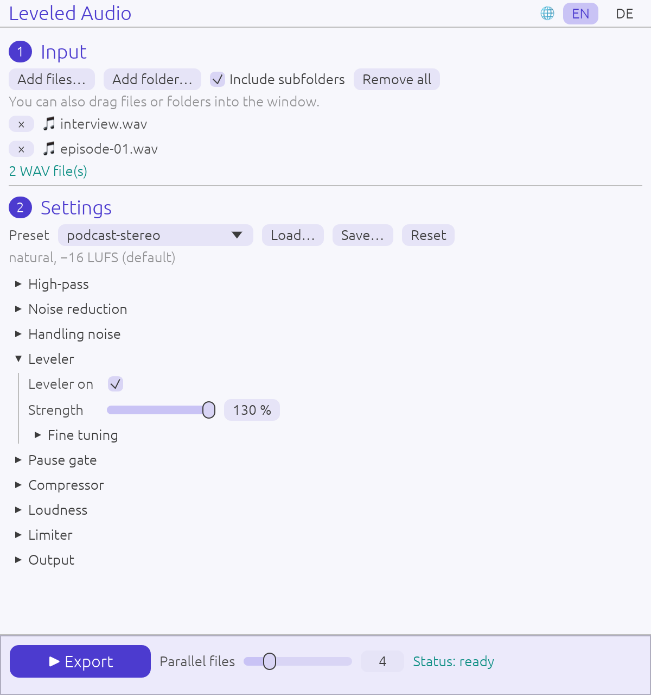
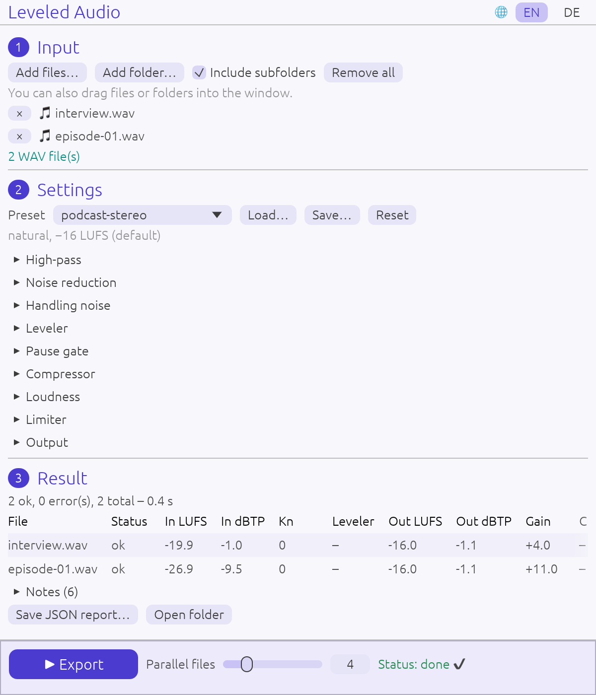

# Leveled Audio

**English** · [Deutsch](README.de.md)

Batch processing for speech recordings (WAV): offline, no runtime dependencies. You can use it as a desktop app (**Leveled Audio**) or as the command-line tool `leveled-audio`.

<p align="center">
  
  
</p>

**Status: Phase 6.** Implemented so far:

- High-pass filter.
- Noise reduction with an automatic noise profile.
- Detection and reduction of handling noise.
- Adaptive leveler.
- Compressor and optional pause gate.
- Loudness normalization (ITU-R BS.1770-4 / EBU R128, per file or as an album) and a true-peak limiter.
- Layered presets.
- JSON report with a schema.
- Release builds.
- A simple desktop app in English and German.

See [PLAN.md](PLAN.md) (German).

**Processing chain:** high-pass → noise reduction + handling-noise reduction → leveler (+ pause gate) → compressor → normalization → true-peak limiter.

The noise profile comes automatically from the quietest stationary pauses in each file. If there are none, minimum statistics is used instead. The leveler evens out speakers and phrases of different loudness. Gain changes happen in the pauses, and pauses are not raised.

**User guide:** [docs/GUIDE.md](docs/GUIDE.md) (English) · [docs/ANLEITUNG.md](docs/ANLEITUNG.md) (Deutsch) · **Report schema:** [docs/report.schema.json](docs/report.schema.json)

## Desktop app

- **Steps:** add files or folders, pick a preset and adjust the settings, then click **Export**.
- **Output file:** each output file is saved **next to its original** as `name-leveled-<preset>.wav`. If an output file already exists, the app asks before overwriting it.
- **Language:** the app starts in English. Use **EN | DE** at the top right to switch to German.

- **macOS:** `Leveled Audio.app` (in the release archive, or build it yourself with `scripts/macos-app.sh`). Opens without a terminal window. It isn't notarized, so the first time you need to right-click → Open.
- **Windows:** `leveled-audio-gui.exe`, no console window.
- **Linux:** `leveled-audio-gui`.

Details: [Guide, section 3a](docs/GUIDE.md#3a-desktop-app-leveled-audio-leveled-audio-gui).

## Installation

Ready-made binaries for macOS (universal), Windows and Linux (static) are attached to every GitHub release, see [Guide, section 1](docs/GUIDE.md#1-installation). To build them yourself:

```bash
cargo build --release
scripts/macos-app.sh        # macOS only: creates target/release/Leveled Audio.app
```

The command-line binary is then at `target/release/leveled-audio`.

To create a release, push a tag: `git tag v0.1.0 && git push origin v0.1.0`. The workflow `.github/workflows/release.yml` then builds all platforms, checks the binaries and uploads them together with `SHA256SUMS.txt`.

## Command line

```bash
# Bring a folder (recursively) to −16 LUFS / −1 dBTP
leveled-audio process recordings/ -r -o done/

# EBU R128 (−23 LUFS), 24 bit, with JSON report
leveled-audio process interview.wav -o done/ --preset ebu-r128 --bit-depth 24 --report-json report.json

# Check: removed signal as <name>.delta.wav, save noise profiles
leveled-audio process recordings/ -o done/ --export-delta --save-profiles profiles/

# Force one profile (e.g. from a room-tone recording) for all files
leveled-audio profile learn roomtone.wav -o studio.json
leveled-audio process recordings/ -o done/ --noise-profile studio.json

# Album: one shared gain, relative differences remain
leveled-audio process season/ -o done/ --loudness-mode album

# Custom preset (missing values come from the base preset) and single overrides
leveled-audio preset show ebu-r128 > my.toml
leveled-audio process recordings/ -o done/ --preset my.toml --set denoise.reduction_db=15

# Punchier sound (near-silent pauses, denser) instead of natural
leveled-audio process recordings/ -o done/ --preset podcast-kraeftig

# Individual controls (recommendations and effect: guide, section 4)
leveled-audio process interview.wav -o done/ --pause-floor -60 --compression 60 --knock-reduction 20

# Gentler leveler (default 130 %, overcorrecting) or none at all
leveled-audio process interview.wav -o done/ --leveler-strength 60
leveled-audio process interview.wav -o done/ --no-leveler

# Stronger noise reduction, or none at all
leveled-audio process interview.wav -o done/ --reduction-db 18
leveled-audio process interview.wav -o done/ --no-denoise

# Measure only (incl. noise level and profile confidence)
leveled-audio analyze recordings/*.wav
```

The command-line tool's messages and tables are in German.

Key properties:

- **Input:** WAV/RF64, PCM 16/24/32-bit int and 32-bit float, mono/stereo.
- **Output:** 16/24 bit or 32-bit float. Files over 4 GiB are written as RF64 automatically.
- **Existing files:** existing output files are only replaced with `--overwrite`. Input files never are.
- **Cancelling:** Ctrl+C cancels cleanly and deletes partial files (exit code 130).
- **Exit codes:** 0 = ok, 1 = at least one file failed, 2 = usage error, 130 = cancelled.
- **Deterministic:** the same input and settings produce byte-identical output.

## Development

```bash
cargo test --workspace
cargo clippy --workspace --all-targets -- -D warnings
cargo fmt --all
```

To regenerate the screenshots and the app icon:

```bash
cargo run --release -p leveled-audio-gui --example screenshots -- /path/to/workdir docs/images
scripts/make-icon.py 1024 assets/icon.png && scripts/make-icon.py 256 assets/icon-256.png
```

License: MIT OR Apache-2.0.
