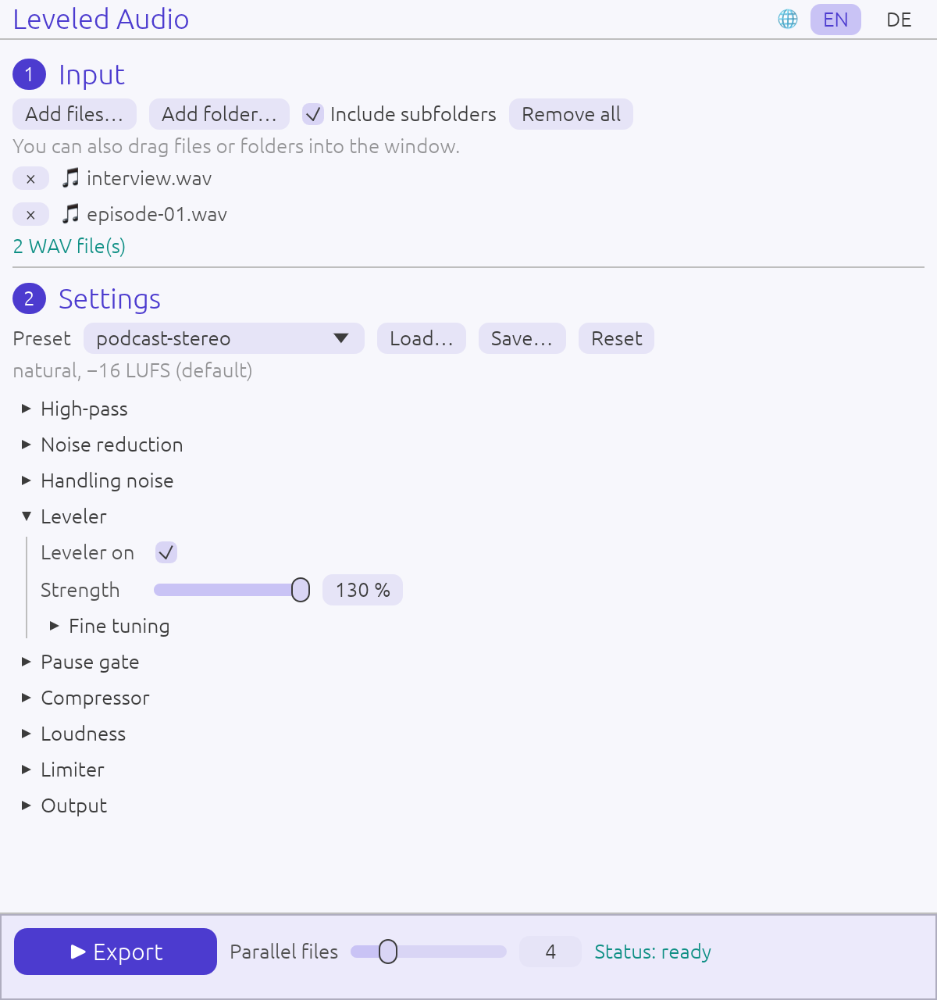
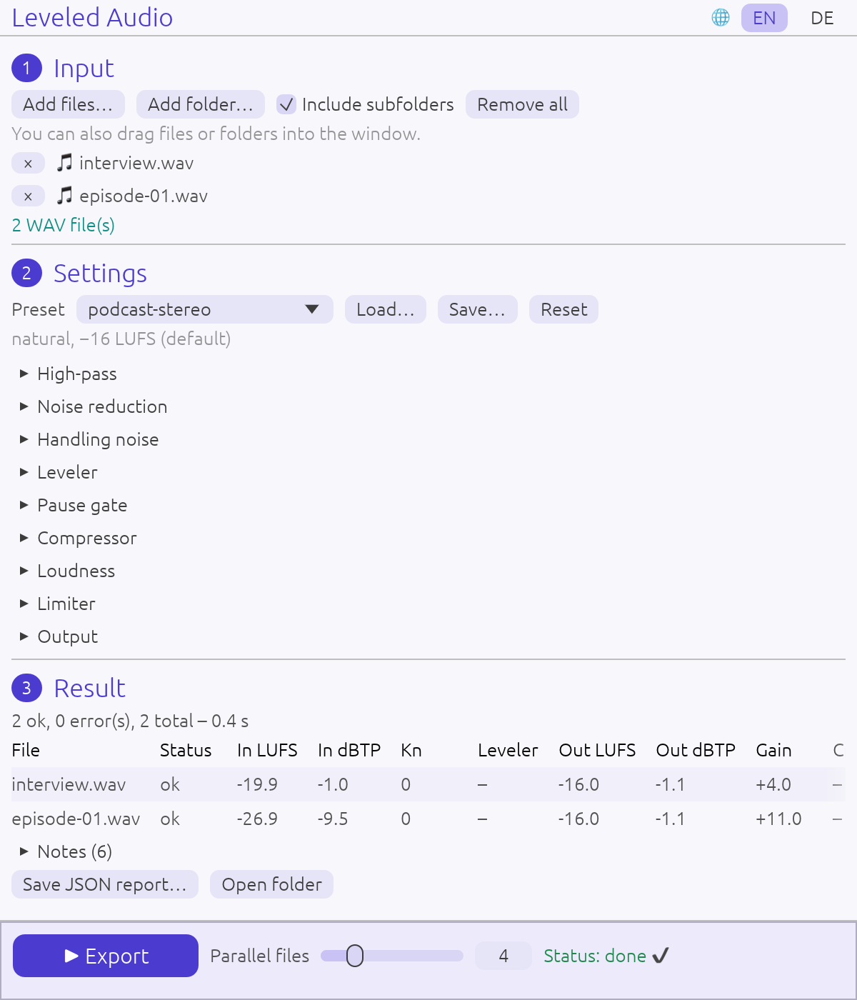

# Leveled Audio / leveled-audio – User guide

**English** · [Deutsch](ANLEITUNG.md)

Leveled Audio (desktop app) and `leveled-audio` (command line) process speech recordings (WAV) in batches, offline and without any further installation:

```
High-pass → noise reduction + handling-noise reduction → leveler (+ pause gate)
          → compressor → loudness normalization → true-peak limiter → output
```

- **High-pass:** Removes rumble and footstep noise below about 70 Hz.
- **Noise reduction:** The noise profile is taken automatically from the quietest pauses of each file and subtracted spectrally.
- **Handling-noise reduction:** Detects handling noise and knocks (low-frequency disturbances without speech content) and reduces the lows there. The leveler does not boost them.
- **Leveler:** Evens out speakers and phrases of different loudness. Gain changes happen in the pauses, and pauses are not raised.
- **Pause gate** (optional, off by default): Lowers speech pauses to a target level.
- **Compressor:** Gently catches short loud passages (laughter, exclamations) before the limiter has to clamp hard.
- **Normalization:** Brings the integrated loudness (ITU-R BS.1770-4 / EBU R128) to the target, per file or as an album.
- **True-peak limiter:** Keeps to the ceiling with 8× oversampling (default −1 dBTP).

Input files are never modified.

> **Language:** The desktop app can be switched between English and German. The command-line tool's messages, tables and preset comments are in German. This guide explains the German column names where needed.

---

## 1. Installation

Download the archive for your system from the releases page and unpack it:

| System | Archive |
|---|---|
| macOS (Apple Silicon and Intel) | `leveled-audio-<version>-universal-apple-darwin.tar.gz` |
| macOS Apple Silicon only / Intel only | `…-aarch64-apple-darwin` / `…-x86_64-apple-darwin` |
| Windows 10/11 (64 bit) | `leveled-audio-<version>-x86_64-pc-windows-msvc.zip` |
| Linux (64 bit, any distribution) | `leveled-audio-<version>-x86_64-unknown-linux-musl.tar.gz` |

The binaries have no runtime dependencies. Windows does not need the VC++ redistributable, and the Linux binary is statically linked. Checksums are in `SHA256SUMS.txt`:

```bash
shasum -a 256 -c SHA256SUMS.txt --ignore-missing      # macOS
sha256sum -c SHA256SUMS.txt --ignore-missing          # Linux
```

**macOS:** The binaries are not signed, so Gatekeeper blocks the program the first time. Remove the quarantine flag:

```bash
xattr -d com.apple.quarantine ./leveled-audio
```

Put `leveled-audio` (or `leveled-audio.exe`) in a folder on your `PATH`, e.g. `/usr/local/bin` or `~/bin`.

**Desktop app:** The archive also contains `leveled-audio-gui` (Windows: `leveled-audio-gui.exe`), and on macOS `Leveled Audio.app`. On Linux it comes as a separate archive, `…-x86_64-unknown-linux-gnu`. It needs the graphics and GTK libraries of a normal desktop (X11 or Wayland, GTK 3), which every desktop distribution ships. See section 3a.

---

## 2. Quick start

```bash
# Process a folder recursively: −16 LUFS, −1 dBTP, noise reduction and leveler on
leveled-audio process recordings/ -r -o done/

# Measure only, write nothing
leveled-audio analyze recordings/ -r
```

After processing, a table lists all files. Example (column names are German):

```
Datei     LUFS  dBTP │   dBFS Konf    NR  Kn │ Leveler │   LUFS  dBTP  LRA │  Gain  Kmp  Lim  Status
          ─ Eingang ── │ ───── Rauschen ────── │         │ ──── Ausgang ──── │
004.wav  -25.4  -0.7 │  -54.2 0.83 -11.3  21 │   -3…+7 │  -16.3  -1.1  3.3 │ +10.6  0.4  3.6  ok
```

| Column | Meaning |
|---|---|
| Datei | file |
| Eingang LUFS / dBTP | integrated loudness and true peak of the input |
| Rauschen dBFS | level of the noise profile |
| Konf | confidence of the profile, 0–1. **MS** means no quiet pauses were found and minimum statistics is used instead. **imp** means the profile was imported. |
| NR | average reduction in the pauses (dB) |
| Kn | number of detected knocks or handling noises |
| Leveler | gain range of the leveler in speech (dB) |
| Ausgang | loudness, true peak and loudness range of the output |
| Gain | normalization gain (dB) |
| Kmp / Lim | largest gain reduction by the compressor or limiter (dB) |

Below the table are notes ("Hinweise"), e.g. about clipped inputs, the pause gate or a loudness correction.

---

## 3. Commands

| Command | Purpose |
|---|---|
| `leveled-audio process <INPUTS>… -o <FOLDER>` | process files |
| `leveled-audio analyze <INPUTS>…` | measure only: loudness, true peak, LRA, noise level, profile confidence, leveler preview |
| `leveled-audio profile learn <WAV> -o <profile.json>` | learn a noise profile from a recording, e.g. room tone |
| `leveled-audio preset list` | list built-in presets |
| `leveled-audio preset show <name or file.toml>` | print a preset in full as TOML |

Inputs can be individual WAV files and folders. With `-r`, subfolders are included and the folder structure is kept in the output. All commands accept `-q` (no output except errors) and `--help`.

### Important options for `process`

| Option | Effect |
|---|---|
| `--preset <name or file.toml>` | `podcast-stereo` (default, natural, −16 LUFS), `podcast-kraeftig` (punchy: near-silent pauses, denser), `podcast-mono` (−19), `ebu-r128` (−23) or your own file |
| `--target-lufs <LUFS>` | target loudness, e.g. `--target-lufs -18` |
| `--ceiling-dbtp <dBTP>` | true-peak ceiling, e.g. `--ceiling-dbtp -2` |
| `--loudness-mode per-file\|album` | loudness per file (default) or one shared gain, see section 6 |
| `--bit-depth same\|16\|24\|32f` | output bit depth (default `same`; 32-bit int inputs become 24 bit) |
| `--reduction-db <dB>` | maximum noise reduction (default 12) |
| `--leveler-strength <0–130>` | leveler strength in percent (default 130; above 100 overcorrects) |
| `--highpass <Hz>` | high-pass frequency (default 70) |
| `--knock-reduction <dB>` | reduction of the lows in knocks (default 15; 0 = detect only) |
| `--compression <0–100>` | compressor in percent (default 40) |
| `--pause-floor <dBFS>` | turn on the pause gate with this target pause level, e.g. `-60` |
| `--no-denoise`, `--no-leveler`, `--no-normalize`, `--no-limiter`, `--no-highpass`, `--no-knock`, `--no-compression`, `--no-pause-floor` | turn off individual stages |
| `--set <KEY=VALUE>` | override any setting, can be repeated, see section 5 |
| `--naming "<pattern>"` | output file name; placeholders `{stem}`, `{ext}`, `{preset}`, `{lufs}` |
| `--overwrite` / `--skip-existing` | replace or skip existing output files (with neither: abort) |
| `-j <N>` | number of files processed in parallel (default: number of cores, at most 4) |
| `--report-json <file>` | report as JSON, see section 7 |
| `--noise-profile <profile.json>` | use this noise profile for all files |
| `--save-profiles <folder>` | save automatically determined profiles as `<name>.noise.json` |
| `--export-delta` | also write the removed signal as `<name>.delta.wav` (for listening) |

Examples:

```bash
# EBU R128, 24 bit, with JSON report
leveled-audio process interview.wav -o done/ --preset ebu-r128 --bit-depth 24 --report-json report.json

# Stronger noise reduction, and check what was removed
leveled-audio process interview.wav -o done/ --reduction-db 18 --export-delta

# One profile from room tone for all files
leveled-audio profile learn roomtone.wav -o studio.json
leveled-audio process recordings/ -o done/ --noise-profile studio.json

# File names with target loudness: interview_-16.wav
leveled-audio process interview.wav -o done/ --naming "{stem}_{lufs}"
```

---

## 3a. Desktop app „Leveled Audio“ (`leveled-audio-gui`)

**Starting without a terminal:**
- **macOS:** The archive contains `Leveled Audio.app`. Drag it into the Applications folder and start it by double-clicking, from Launchpad or from the Dock. The first time, macOS says the app is from an unidentified developer (it is not notarized by Apple). Right-click the app once → Open → Open, or use System Settings → Privacy & Security → "Open Anyway". To build it yourself, run `cargo build --release -p leveled-audio-gui` and then `scripts/macos-app.sh`. The bundle is then at `target/release/Leveled Audio.app`.
- **Windows:** Double-click `leveled-audio-gui.exe`; no console window opens.
- **Linux:** Start `leveled-audio-gui` from the file manager or create a launcher (`.desktop` file).

A simple interface for testing: import files, adjust all settings, export results. It uses the same processing as the command line, so the same settings produce the same files.

**Language:** The app starts in English. Use `EN` / `DE` at the top right to switch between English and German at any time. Warnings and error messages from processing are currently always in German.

<p align="center">
  
  
</p>

The window is laid out from top to bottom:

1. **Input:** "Add files…" and "Add folder…", or drag files and folders into the window. "Include subfolders" is the same as `-r`.
   - The list shows the file names; hover over one to see the full path.
   - Below it you see how many WAV files were found.
   - Already exported files (`-leveled-` in the name) are skipped when importing a folder. If you add one individually, it is processed.
2. **Settings:**
   - Choose a preset, load your own preset, or save the current values as a preset. The saved file also works with `leveled-audio --preset`.
   - "Reset" restores the selected or loaded preset.
   - Below that are all settings, grouped by stage. Each group shows the important controls at the top and the rest under "Fine tuning". Hover over a control to see the short description from section 4.
3. **Export / Cancel** at the bottom of the window, next to the number of parallel files and the status (ready, working, done, cancelled), with overall and per-file progress. Cancelling deletes partial files.
   - Each file is saved **next to its original**: `recording.wav` → `recording-leveled-podcast-stereo.wav` (with a loaded preset, its file name is used).
   - If output files already exist, a dialog asks: "Overwrite", "Skip existing" or "Cancel". Originals are never modified.
4. **Result:** A table like the one on the console (section 2, column names translated), notes, "Save JSON report…" and "Open folder".

Listening, waveform display and preview are not part of this first version.

---

## 4. Controls: recommendations and effect

**Fixed or based on analysis?** The control values are fixed. They are stored in the preset, apply to all files equally, and make the result reproducible. However, almost all controls describe an intention relative to each file:
- Noise reduction works with the automatically found noise profile.
- The leveler aligns to the file's speech level.
- The compressor threshold sits 8 dB above that speech level.
- The pause gate calculates its depth so that the pauses reach their target.
- Handling-noise detection judges each section individually.

What was actually applied is in the report. Only target loudness, peak ceiling and high-pass frequency are absolute.

| Control | Natural (`podcast-stereo`, default) | Punchy (`podcast-kraeftig`) | What changes |
|---|---|---|---|
| `--target-lufs` | −16 | −16 | Overall loudness. Platforms usually normalize to −14 to −16. |
| `--ceiling-dbtp` | −1 | −1 | Upper limit for peaks. Higher relieves the limiter, but risks distortion after MP3/AAC. |
| `--highpass` | 70 Hz | 80 Hz | Removes rumble. Above about 100 Hz, deep voices lose warmth. |
| `--knock-reduction` | 15 dB | 20 dB | Quieter knocks. Simultaneous speech briefly sounds thinner there. |
| `--reduction-db` | 12 dB | 15 dB | Less noise. Above about 15–18 dB, "bubbly" artifacts become likely. |
| `--leveler-strength` | 130 % | 130 % | Also evens out large distance changes (1 m ↔ 5 cm); quiet passages end up slightly above loud ones. 100 % = equally loud; 60 % is more natural and lively, but level differences stay audible. |
| `--compression` | 40 % (1.5:1) | 60 % (2:1) | Loud passages denser. Too high sounds squashed. |
| `--pause-floor` | off | −60 dBFS | Near-silent pauses. May "breathe" at pause edges. |
| `--loudness-mode` | per-file | per-file | `album` only for episodes of one production. |

`leveled-audio preset show <name>` prints a preset with these short descriptions as comments (in German). `leveled-audio process --help` describes every control.

---

## 5. Presets and settings

### Order of layers

Later layers override earlier ones:

```
built-in base preset  ←  preset file  ←  --set  ←  dedicated flags (--target-lufs, --no-leveler …)
```

### Your own preset

```bash
leveled-audio preset show podcast-stereo > my.toml
```

The file contains all settings. You can delete everything you don't want to change. Missing values come from the base preset (`base`, default `podcast-stereo`):

```toml
schema_version = 1
name = "radio"
base = "ebu-r128"        # −23 LUFS as the basis

[denoise]
reduction_db = 15.0

[leveler]
strength = 0.4
```

```bash
leveled-audio process recordings/ -o done/ --preset my.toml
```

Unknown keys are an error. A typo such as `strenght` therefore stops with a message instead of being silently ignored.

### `--set`

With `--set` you can override any single setting without creating a file:

```bash
leveled-audio process a.wav -o done/ --set denoise.reduction_db=15 --set loudness.mode=album
```

### All settings

| Key | Default | Range | Meaning |
|---|---|---|---|
| `highpass.enabled` | `true` | | high-pass on/off |
| `highpass.frequency_hz` | 70 | 20–200 | cutoff frequency (Hz) |
| `denoise.enabled` | `true` | | noise reduction on/off (without it, no handling-noise reduction either) |
| `denoise.gain_rule` | `wiener-dd` | `wiener-dd`, `subtract` | gain rule; `wiener-dd` produces less "musical noise" |
| `denoise.reduction_db` | 12 | 0–40 | maximum reduction (dB) |
| `denoise.oversubtraction` | 1.3 | 0.5–4 | overestimation of the noise |
| `denoise.floor` | 0.05 | 0–1 | spectral floor (`subtract` only) |
| `denoise.release_ms` | 40 | 0–1000 | release time of the gain |
| `denoise.freq_smooth_oct` | 0 | 0–1 | smoothing across frequency (octaves) |
| `denoise.fft_size` | `auto` | `auto`, 512–8192 | FFT size (`auto` ≈ 43 ms) |
| `denoise.stereo_link` | `false` | | same gain for both channels |
| `denoise.profile.min_duration_s` | 0.3 | 0.1–60 | minimum amount of pause material |
| `denoise.profile.target_duration_s` | 2 | ≥ min | amount from which the profile is fully trusted |
| `denoise.profile.statistic` | `trimmed` | `mean`, `trimmed`, `median` | averaging across pauses |
| `denoise.profile.min_confidence` | 0.4 | 0–1 | below this, minimum statistics is used instead |
| `knock.enabled` | `true` | | detect knocks/handling noise |
| `knock.max_speech_to_low_db` | −15 | −30 … −5 | speech band (300–3400 Hz) this far below the lows (20–300 Hz) ⇒ noise |
| `knock.reduction_db` | 15 | 0–40 | reduction of the lows in knocks; 0 = detect only |
| `leveler.enabled` | `true` | | leveler on/off |
| `leveler.strength` | 1.3 | 0–1.3 | 0 = no effect, 1 = full alignment, above that overcorrection |
| `leveler.max_boost_db` | 20 | 0–20 | largest boost |
| `leveler.max_cut_db` | 10 | 0–20 | largest cut |
| `leveler.pause_max_boost_db` | 0 | −10–10 | upper limit of the gain in long pauses |
| `leveler.slew_db_per_s` | 2 | 0.5–10 | largest gain change within a phrase |
| `gate.enabled` | `false` | | pause gate on/off |
| `gate.floor_dbfs` | −60 | −90 … −30 | target pause level in the finished file |
| `gate.max_attenuation_db` | 30 | 0–60 | at most this much additional attenuation |
| `gate.min_pause_ms` | 400 | 100–2000 | shorter pauses stay untouched |
| `gate.hold_ms` | 50 | 0–500 | hold after the last sound before fading out |
| `gate.fade_out_ms` | 150 | 10–1000 | fade into the pause; longer = smoother, but quiet later |
| `gate.fade_in_ms` | 50 | 10–500 | fade in before the next word |
| `gate.pre_open_ms` | 50 | 0–200 | fully open again this much before speech starts |
| `compressor.enabled` | `true` | | compressor on/off |
| `compressor.amount` | 0.4 | 0–1 | 0.4 = 1.5:1, 0.6 = 2:1, 1 = 6:1 |
| `compressor.threshold_above_ref_db` | 8 | 0–20 | threshold above the file's speech level |
| `compressor.attack_ms` | 5 | 0.5–50 | attack time |
| `compressor.release_ms` | 150 | 20–1000 | release time |
| `loudness.enabled` | `true` | | normalization on/off |
| `loudness.target_lufs` | −16 | −70 to −5 | target loudness |
| `loudness.mode` | `per-file` | `per-file`, `album` | see section 6 |
| `limiter.enabled` | `true` | | limiter on/off |
| `limiter.ceiling_dbtp` | −1 | −20–0 | true-peak ceiling |
| `limiter.lookahead_ms` | 5 | 0.5–50 | lookahead |
| `limiter.release_ms` | 100 | 1–2000 | release time |
| `limiter.oversampling` | 8 | 4, 8, 16 | oversampling of peak detection |
| `output.bit_depth` | `same` | `same`, `16`, `24`, `32f` | bit depth |
| `output.dither` | `auto` | `auto`, `on`, `off` | TPDF dither (`auto`: only at 16 bit) |

---

## 6. Loudness: per file or as an album

**Per file** (default): Each file reaches the target on its own.

**Album** (`--loudness-mode album`): All files of one run get the **same** gain, and their combined loudness reaches the target. Differences between the files are kept, e.g. a quieter intro compared with the main part. To do this, all files are analyzed first and rendered only afterwards. An album line with gain and album loudness appears above the table.

Files with errors and skipped files (`--skip-existing`) don't count towards the album loudness.

**Correction for heavy limiting:** When the limiter steps in, the loudness ends up slightly below the target. Leveled Audio estimates this loss while measuring and compensates for it in the gain. If the finished file still misses the target by more than 0.3 LU, leveled-audio renders it again with an adjusted gain (in album mode, all files). This happens at most twice. Larger corrections (from 0.5 dB) are listed under "Hinweise" below the table.

---

## 7. JSON report

`--report-json report.json` with `process`, or `--json report.json` with `analyze`, writes all measurements in machine-readable form. The format is described in `report.schema.json` (JSON Schema 2020-12).

- Files appear in input order, regardless of which finished first.
- `settings` contains the complete effective settings. `settings_hash` is a checksum over them: two reports with the same checksum were processed identically.
- `summary` counts the results (ok, skipped, error, cancelled).
- `album` appears only in album mode.
- Each file has a `status`: `ok` with `report`, `skipped`, `error` with `message`, or `cancelled`. Values that could not be determined are `null`.

---

## 8. Safety, cancelling, exit codes

- Input files are never overwritten, not even with `--overwrite`.
- Outputs are first written as `<name>.partial` and renamed only on success, so no half-written files are left behind.
- **Ctrl+C** finishes the running files cleanly and deletes partial files. A second Ctrl+C exits immediately.
- A broken input file does not stop the batch. It appears as FEHLER (error) in the table and in the report.

| Exit code | Meaning |
|---|---|
| 0 | everything ok |
| 1 | at least one file failed (the others are done) |
| 2 | usage error (wrong option, unknown preset, output exists …) |
| 130 | cancelled with Ctrl+C |

The same input, settings and binary produce byte-identical outputs. Between different CPU architectures, e.g. Apple Silicon and Intel, individual samples differ by a few LSB (difference below −120 dBFS).

---

## 9. Formats and limits

- **Input:** WAV and RF64, PCM 16/24/32-bit int and 32-bit float, mono and stereo, common sample rates (tested with 16–96 kHz).
- **Output:** WAV with 16/24 bit or 32-bit float. From 4 GiB, RF64 is written automatically.
- **Long files:** Memory use is nearly constant; a 3-hour stereo file needs about 100 MB. In album mode, about 10 MB per hour of audio per file stays in memory until rendering.
- **Speed:** On a current computer about 55× real time per file with all stages (measured on a 1-hour stereo file). Very short files with a subsequent loudness correction are slower. Several files run in parallel.
- **Cannot be repaired:** Inputs that are already clipped. They are detected and reported.
- **Known quirks:**
  - Music and jingles are leveled too.
  - A changing microphone distance within a phrase is only evened out slowly. This is a deliberate compromise against "pumping".

---

## 10. Frequently asked questions

**The confidence is low, or "MS" appears in the table.**
The recording has hardly any quiet pauses. A short room-tone recording helps: learn a profile from it with `profile learn` and use it with `--noise-profile`.

**Knocks or handling noise are still audible.**
Increase `--knock-reduction` (e.g. 25). If a knock is not detected because it also has a lot of energy in the speech band, a higher value for `--set knock.max_speech_to_low_db=-12` helps. However, this increases the risk that very low speech sounds are reduced too.

**The pauses should be quieter.**
Use `--pause-floor -60` or the `podcast-kraeftig` preset. If you hear the noise coming and going at the pause edges, choose a higher target (e.g. −55) or additionally reduce the noise with `--reduction-db 15`.

**The noise reduction sounds bubbly or metallic.**
Lower `--reduction-db` (e.g. to 8). Listen to what is removed with `--export-delta`. No speech should be audible in the delta file.

**The leveler boosts too much or too little.**
Change `--leveler-strength` (0–130) or limit it with `--set leveler.max_boost_db=6`. The boost is capped at `leveler.max_boost_db` (default 20 dB).

Short, noise-like sounds between phrases (breathing, rustling, handling the microphone) are not boosted by the leveler, even if the voice detection classifies them as speech.

**The output is quieter than the target.**
If the notes say the target was missed, the limiter is working very hard. This mostly affects material that is already heavily compressed, or large boosts. A quieter target or a higher ceiling helps, e.g. `--ceiling-dbtp -0.5`.
